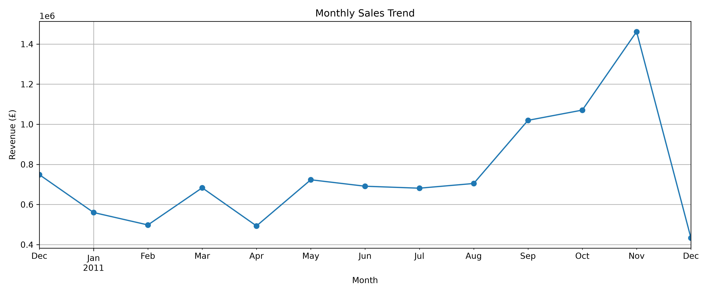
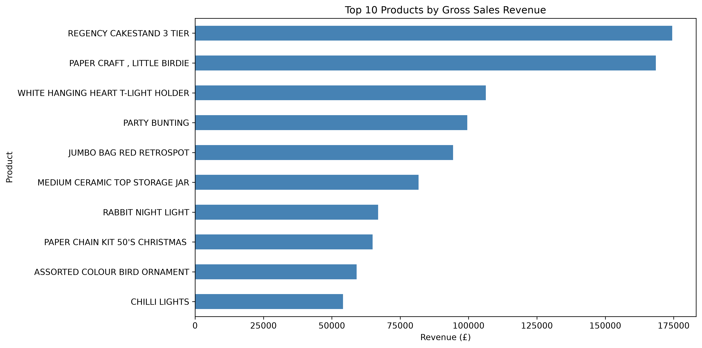
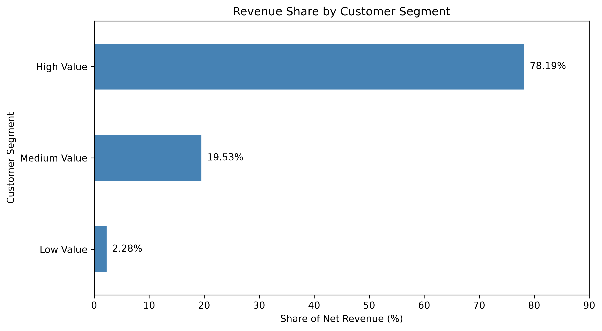
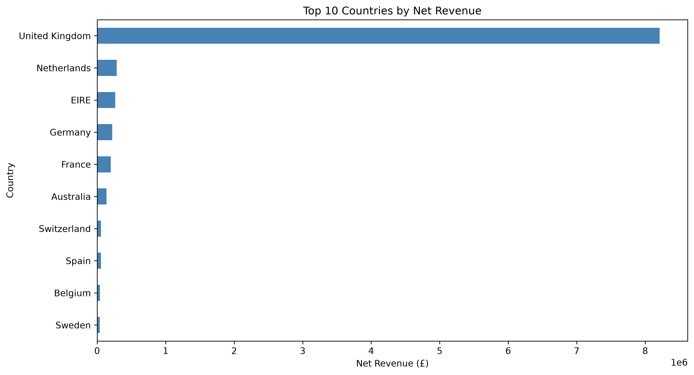

# E-Commerce Sales & Customer Analysis Using Python

## Project Overview

This project analyzes transactional data from a UK-based online retailer using Python to identify sales trends, top-performing products, customer purchasing behavior, and revenue distribution across countries.

The analysis covers 541,909 transaction records from the UCI Online Retail dataset.

### Business Objectives

- Analyze monthly sales trends and revenue performance.
- Identify top-selling products by revenue.
- Compare customer purchasing frequency and order value.
- Segment customers based on net transaction revenue.
- Evaluate revenue concentration across geographic markets.
- Generate actionable business insights to support data-driven decisions.

### Tools & Technologies

- **Python** — Data analysis
- **Pandas** — Data cleaning, transformation, and aggregation
- **Matplotlib** — Data visualization
- **Jupyter Notebook** — Exploratory data analysis
- **VS Code** — Development environment

## Key Business Insights

### 1. Sales Performance
- Total net transaction revenue was approximately **£9.77 million**, after accounting for negative transactions.
- **November 2011** recorded the highest monthly net revenue at approximately **£1.46 million**.
- December 2011 contains only partial-month data and should not be directly compared with complete months.

### 2. Product Performance
- **REGENCY CAKESTAND 3 TIER** generated approximately **£174,485** in gross sales revenue.
- Postage charges and manual entries were excluded from the preliminary product ranking.

### 3. Customer Analysis
- The dataset contained **4,371 unique customer IDs**.
- **4,322 customers** had positive net transaction revenue in the customer summary.
- The top 25% of positive-net-revenue customers generated **78.19%** of the revenue within that customer group.
- Customer **14646** generated £280,206 in gross sales across 73 orders.
- Customer **12748** placed 209 orders, demonstrating that high purchase frequency does not necessarily mean high revenue.

### 4. Geographic Analysis
- The **United Kingdom** accounted for **84.03%** of total net transaction revenue.
- The Netherlands and Ireland were the next largest markets by net transaction revenue.

## Business Recommendations

- Investigate retention strategies for high-value customers.
- Evaluate opportunities to diversify revenue beyond the UK market.
- Consider both purchase frequency and revenue when identifying valuable customers.
- Account for cancellations when assessing customer value and sales performance.

## Data Visualizations

### 1. Monthly Sales Trend

### 2. Top 10 Products by Gross Sales Revenue

### 3. Revenue Share by Customer Segment

### 4. Top 10 Countries by Net Revenue

## Dataset Source

This project uses the Online Retail dataset from the
UCI Machine Learning Repository.

Dataset:
https://archive.ics.uci.edu/dataset/352/online+retail

The dataset contains 541,909 transaction records.

To reproduce the analysis:
1. Download the dataset from the link above.
2. Create a folder named `data` in the project directory.
3. Place `Online Retail.xlsx` inside the `data` folder.